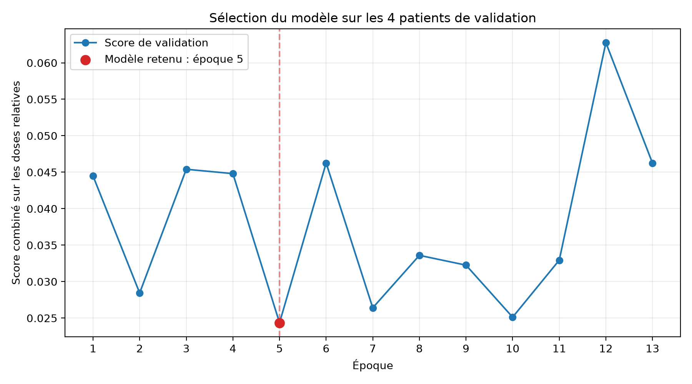
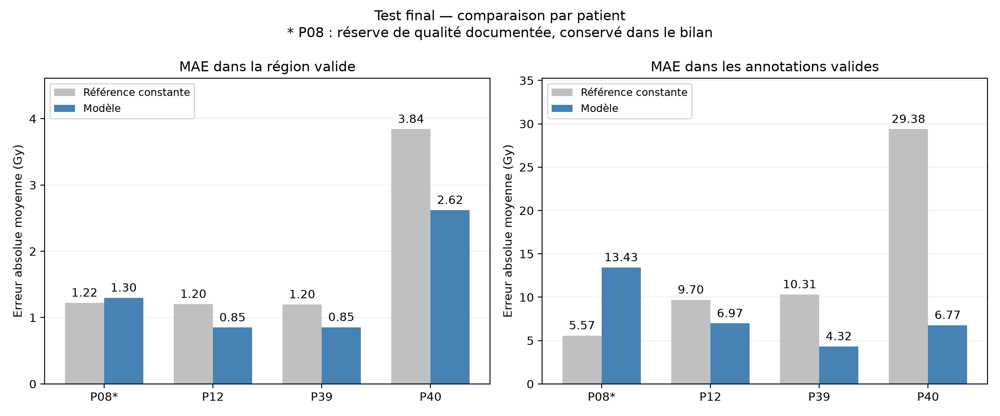

# Brain Radiotherapy Dose Prediction with a Compact 2D U-Net

Prediction of brain radiotherapy dose maps from contrast-enhanced MRI, tumor annotations and prescription information using a compact neural network trained on CPU.

Developed by **Mohamed Fadel** at **Université Euromed de Fès**, as part of the medical imaging module.

**Experimental educational prototype — not validated for clinical use.**

## Overview

This project investigates whether a compact 2D U-Net can learn to estimate radiotherapy dose distributions from existing treatment examples.

The workflow includes:

- Medical imaging data inspection and quality checks.
- MRI and dose preprocessing.
- Patient-level training, validation and test separation.
- CPU-based model training and selection.
- Comparison with a constant-dose baseline.
- Quantitative evaluation and dose-map visualization.

The model predicts dose maps. It does not optimize beam parameters or generate a deliverable treatment plan.

## Inputs and output

Each MRI slice is represented by six input channels.

| Channel | Content |
|---|---|
| 1 | Contrast-enhanced T1 MRI normalized between 0 and 1 |
| 2 | Binary annotation mask for label 1 |
| 3 | Binary annotation mask for label 2 |
| 4 | Binary annotation mask for label 3 |
| 5 | Constant image containing prescribed dose divided by 35 Gy |
| 6 | Constant image containing fraction count divided by 7 |

Input shape: **6 × 240 × 240**.

Output shape: **1 × 240 × 240**, containing the predicted relative dose.

Dose normalization:

```text
Relative dose = dose in Gy / prescribed dose in Gy
Dose in Gy = relative dose × prescribed dose in Gy
```

The prescription and fraction-count divisors are fixed input scaling factors. They do not impose a maximum predicted dose.

The model uses annotations supplied with the dataset. It was not evaluated using predictions from the separate segmentation component.

## Dataset

The project uses a subset of the **PROTEAS brain metastases dataset**, which provides imaging, tumor annotations and radiotherapy information.

### References and access

Flouri, D., et al. (2025).
*A longitudinal MRI dataset of brain metastases with tumor segmentations, clinical & radiomic data.*
Scientific Data, 12, 1828.

[Dataset publication](https://doi.org/10.1038/s41597-025-06131-0)

[Zenodo dataset record linked by the publication — version v3](https://doi.org/10.5281/zenodo.17253793)

The exact downloaded dataset version used in this experiment remains to be confirmed. The linked record should not be interpreted as confirmation of the experimental version.

The complete dataset contains 40 patients. This project examined 35 patient records and retained 24 following quality checks.

Patient volumes, original DICOM files and model checkpoints are not included in this repository. Obtain the source data separately and follow its applicable license and attribution terms.

### Experimental split

| Split | Patients | Usable slices |
|---|---:|---:|
| Training | 16 | 2,132 |
| Validation | 4 | 534 |
| Test | 4 | 531 |
| Total | 24 | 3,197 |

All slices belonging to one patient remain in the same split.

The test patients are **P08, P12, P39 and P40**.

P08 remains included with a documented data-quality reservation concerning the correspondence between annotations and treated targets.

## Preprocessing

The preparation workflow includes:

- Checking file availability and spatial grids.
- Normalizing the MRI.
- Constructing binary annotation channels.
- Dividing reference dose by the prescribed dose.
- Creating masks identifying valid dose values.
- Excluding invalid dose values from loss and metric calculations.

The original implementation expects prepared volumes of size **240 × 240 × 155** and processes their usable axial slices independently.

Numerical preparation checks do not establish clinical validity or guarantee anatomical alignment.

## Model

The network is a compact adaptation of the 2D U-Net architecture.

| Component | Description |
|---|---|
| Encoder | Convolution blocks with ReLU and max-pooling |
| Feature widths | 8, 16 and 32 channels |
| Decoder | Transposed convolutions, concatenation and convolution blocks |
| Skip connections | Transfer encoder features to the decoder |
| Output layer | 1 × 1 convolution followed by Softplus |
| Trainable parameters | 29,681 |

Softplus produces non-negative dose predictions without imposing an upper bound.

### Architecture reference

Ronneberger, O., Fischer, P., and Brox, T. (2015).
*U-Net: Convolutional Networks for Biomedical Image Segmentation.*

[Paper](https://arxiv.org/abs/1505.04597)

## Training

| Setting | Original experiment |
|---|---|
| Device | CPU |
| Optimizer | Adam |
| Learning rate | 0.001 |
| Batch size | 4 slices |
| Maximum epochs | 40 |
| Early-stopping patience | 8 epochs |
| Selected epoch | 5 |
| Final training epoch | 13 |

The training loss combines two mean squared errors:

```text
Loss = 0.5 × MSE over valid-dose pixels
     + 0.5 × MSE over valid annotated pixels
```

For batches without valid annotated pixels, only the valid-dose term is used.

Model selection uses validation performance. Test patients are excluded from training and model selection.

## Evaluation

The model is compared with a constant relative-dose baseline calculated from training data separately for each fractionation group.

Evaluation includes:

- **MAE:** mean absolute dose error.
- **RMSE:** dose error with greater sensitivity to large deviations.
- **Dice:** overlap between predicted and reference regions receiving at least 95% of the prescribed dose.

MAE and RMSE are reported in Gy, both over the valid-dose region and over valid annotated regions.

Metrics are calculated per patient and then averaged with equal weight per patient.

## Reported results

The following values come from the original experiment.

| Metric | Constant baseline | U-Net |
|---|---:|---:|
| MAE in valid-dose region, Gy | 1.87 | 1.41 |
| MAE in valid annotations, Gy | 13.74 | 7.87 |
| RMSE in valid-dose region, Gy | 3.06 | 2.48 |
| RMSE in valid annotations, Gy | 16.08 | 10.00 |
| Dice at 95% of prescription | 0.000 | 0.315 |

The U-Net reduces average dose errors compared with the baseline. However, errors within annotated regions remain substantial, and high-dose overlap remains limited.

These results indicate partial learning of the dose distribution. They do not establish clinical suitability.

### Observed failure modes

- **P08:** a false high-dose focus in an annotated region receiving low reference dose.
- **P39:** localization of the main focus with an underestimated high-dose extent.
- **P40:** an overly concentrated prediction, combining an excessive maximum with an insufficient high-dose extent.

## Results figures

### Validation performance



The original experiment selected epoch 5 using validation performance.
Training stopped after eight subsequent epochs without improvement.

### Errors by test patient



Comparison of the U-Net and constant baseline for individual test patients.
Global errors and errors within annotated regions are shown separately.
P08 remains included with its documented data-quality reservation.

These charts describe the original experiment; they were not regenerated
during the repository reorganization.

## Repository contents

| Path | Purpose |
|---|---|
| `src/configuration.py` | Shared configuration and path resolution |
| `src/preparer_candidats.py` | Prepare selected patient volumes |
| `src/inventorier_coupes.py` | Inventory slices and assign patient splits |
| `src/essai_modele.py` | Define and check the compact U-Net |
| `src/entrainer_modele.py` | Train and select the model |
| `src/evaluer_test.py` | Evaluate the selected checkpoint |
| `src/visualiser_validation.py` | Visualize validation predictions |
| `src/visualiser_relief_test.py` | Generate dose surface plots |
| `src/synthetiser_resultats.py` | Summarize training and test results |
| `src/illustrer_six_canaux.py` | Illustrate the six input channels |
| `configs/experiment.json` | Original experiment settings |
| `check_setup.py` | Check paths and patient assignments |
| `check_model.py` | Compare cleaned and original model outputs |
| `record_environment.py` | Record installed dependency versions |
| `requirements.txt` | Main Python dependencies |
| `requirements-tested.txt` | Exact installed dependency versions |
| `docs/tested_environment.txt` | Recorded Python version and platform |

Several checks intentionally preserve assumptions of the original experiment, including split sizes and volume dimensions. This repository is not a general-purpose radiotherapy framework.

## Tested environment

The setup and synthetic model checks passed in the following environment:

| Software | Version |
|---|---|
| Python | 3.14.7 |
| Operating system | Windows, AMD64 |
| NumPy | 2.5.4 |
| NiBabel | 5.4.2 |
| pydicom | 3.0.2 |
| Matplotlib | 3.11.2 |
| PyTorch | 2.15.0+cpu |

These versions describe the environment used for the repository checks. They do not establish which versions were used during the original training run.

`requirements-tested.txt` records the five direct dependency versions; it is not a complete environment lockfile.

## Installation

From the repository root:

```bash
python -m pip install -r requirements.txt
```

This installs the main dependencies without pinning their versions. Consult the tested environment above when reproducing the checks.

Data and checkpoints must be obtained separately.

## Configuration

Default settings are stored in:

```text
configs/experiment.json
```

They initially reference the original project folder beside this repository.

For another local layout, create:

```text
configs/local.json
```

Example:

```json
{
  "source_root": "D:/datasets/radiotherapie_ia",
  "prepared_dir": "D:/datasets/radiotherapie_ia/data/prepared_batch",
  "inventory_dir": "D:/datasets/radiotherapie_ia/data/prepared_batch/inventory",
  "training_dir": "D:/experiments/original_training",
  "test_dir": "D:/experiments/original_test"
}
```

Replace the example paths with existing directories.

Relative paths are resolved from the repository root. Values in `local.json` override matching settings in `experiment.json`.

`configs/local.json` is excluded from Git.

## Verification

Check the configured folders and patient split:

```bash
python check_setup.py
```

This verifies directory availability, checkpoint presence, split sizes, absence of patient overlap and test-patient identifiers.

Check checkpoint compatibility and synthetic prediction equivalence:

```bash
python check_model.py
```

This loads the saved weights into the cleaned and original model implementations, then compares their outputs for the same synthetic input.

The model comparison requires the original `src/essai_modele.py` under `source_root`.

### Verification status

- Python syntax checks passed.
- Configured paths and patient-split checks passed.
- The original epoch-5 checkpoint loaded successfully.
- The parameter count was confirmed as 29,681.
- Synthetic output shape was confirmed as 1 × 1 × 240 × 240.
- Synthetic predictions were finite and non-negative.
- Cleaned and original model outputs were exactly identical for the tested synthetic input.

The reorganized evaluation pipeline was rerun locally using the original
epoch-5 checkpoint on P08, P12, P39 and P40, comprising 531 usable slices.
All five reported U-Net and baseline averages matched the original results
at the displayed precision. No retraining was performed.
## Running the workflow

Run commands from the repository root.

### Preparation

Full preprocessing requires the original source-file layout and the patient-selection CSV at:

```text
<source_root>/docs/selection_patients.csv
```

Prepare the selected patients:

```bash
python src/preparer_candidats.py
```

Preparation creates a new timestamped batch under the repository's `data` directory.

Update `prepared_dir` to the generated batch, then inventory its slices:

```bash
python src/inventorier_coupes.py
```

If multiple inventories exist, set `inventory_dir` explicitly.

### Training

```bash
python src/entrainer_modele.py
```

Training creates a new timestamped directory under `resultats`.

Before using a newly trained model, update `training_dir` and `expected_epoch` to match the selected checkpoint. The supplied epoch value of 5 belongs to the original experiment.

### Validation visualization

```bash
python src/visualiser_validation.py
```

### Test evaluation

```bash
python src/evaluer_test.py
```

Evaluation uses the configured checkpoint and test protocol. It creates a new timestamped test directory under `resultats`.

Set `test_dir` to the generated directory before producing summaries or relief plots. This configuration value is not updated automatically.

### Results and figures

```bash
python src/synthetiser_resultats.py
python src/illustrer_six_canaux.py
python src/visualiser_relief_test.py
```

## Limitations and future work

- Small training and test cohorts.
- No explicit input identifying which annotated lesions were targeted by treatment.
- Independent processing of slices without neighboring-slice context.
- Limited overlap of high-dose regions.
- Remaining data-quality uncertainty for P08.
- No external or clinical validation.
- Evaluation reproduction was checked locally with the existing checkpoint
  and prepared data. Reproduction from a fresh dataset download and a new
  training run has not been verified.

Potential improvements include verified treatment-target inputs, larger controlled datasets, neighboring-slice information and comparison of losses emphasizing high-dose regions.

Improvements guided by the current test findings require evaluation on new independent data.

## Contributions

**Mohamed Fadel:** radiotherapy dose-prediction component.

This work formed part of a joint academic project with **Nizar Samri**, who developed a separate segmentation component.

The two components were not evaluated as an integrated segmentation-to-dose pipeline.

## License

Original project code is distributed under the [MIT License](LICENSE).

The PROTEAS dataset remains subject to its own license and attribution
requirements. This code license does not relicense third-party material.